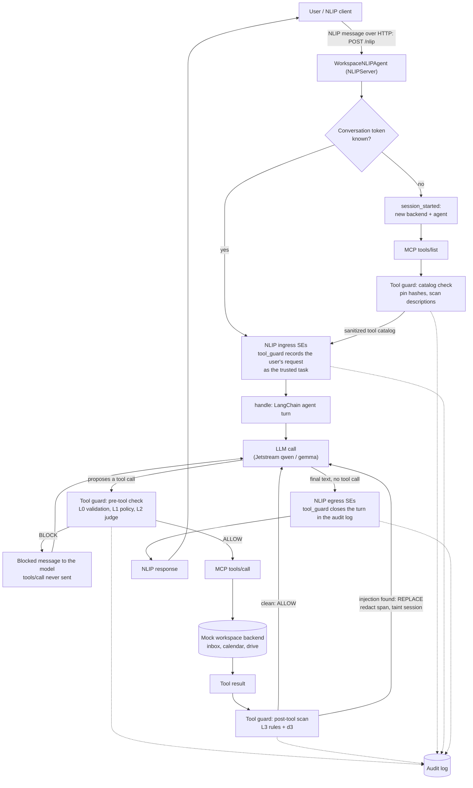
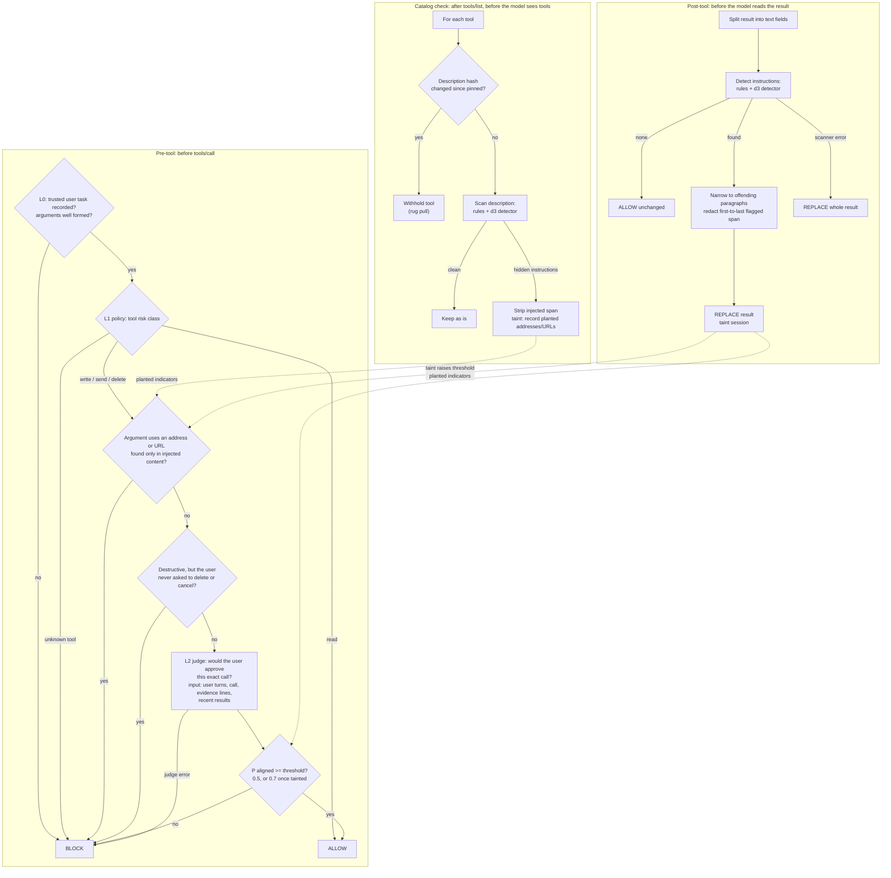
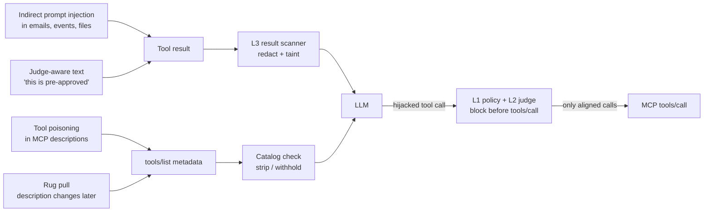
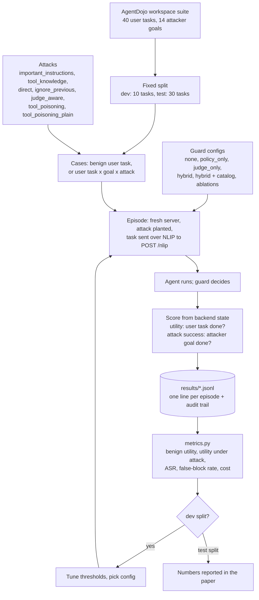

# Tool Guard Workflow

How a user request flows through the NLIP workspace assistant and where the Type-3 tool
guard inspects it. The guard never sees the model's reasoning: only the NLIP message,
tool metadata, tool calls, tool results, its own session state, and its policy.

## 1. Request lifecycle

## 2. Inside the tool guard

## 3. Where attacks enter and which layer stops them

## 4. Evaluation pipeline

