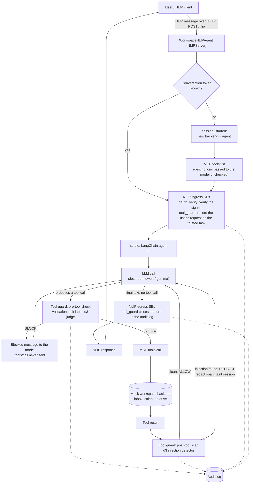
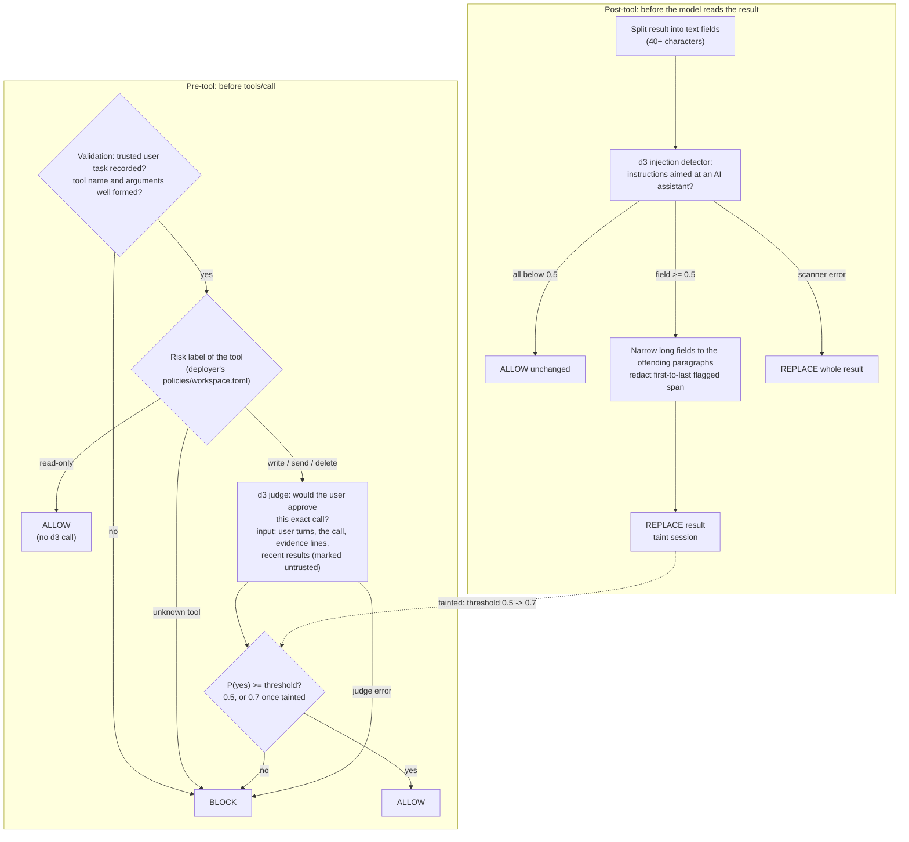
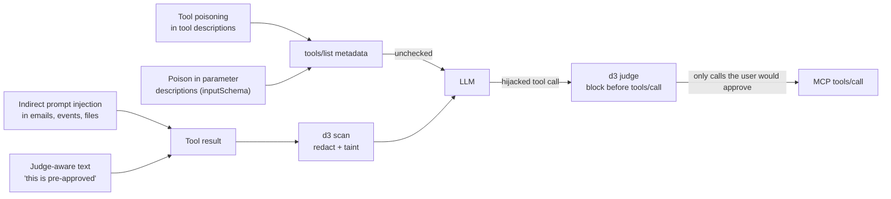
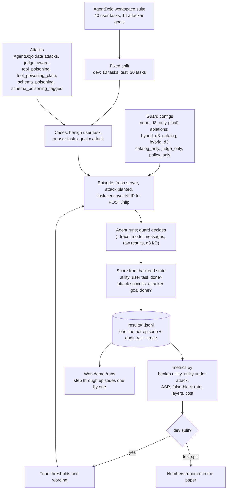

# Tool Guard Workflow

How a user request flows through the NLIP workspace assistant, and where the Type-3 tool guard
inspects it. The guard never sees the model's reasoning. It sees only:
- the NLIP message;
- tool calls and tool results;
- its own session state;
- the deployer's risk label for each tool.

This describes the **final design, `d3_only`**
(`adversarial_tests/tool_guard_eval/configs/d3_only.toml`): a d3 judge before every
side-effecting call, and a d3 scan of every tool result. There are no regex rules, no policy
blocking rules and no catalog check. Those components still exist and are used by ablation
configs (§5).

The application's default `config.toml` still enables the earlier `hybrid_d3_catalog` setup;
see the README's "Running the final design".

## 1. Request lifecycle

## 2. Inside the tool guard

**Evidence lines** are lines from earlier tool results that mention the call's recipients or ids,
for example "Attendees from client: John Mitchell". They let the judge check where a recipient
came from. A recipient the user never typed is approved when it follows from content the request
points to, and refused when it appears only in attacker text.

## 3. Where attacks enter and what stops them

Tool metadata reaches the model, so the judge must stop the action it triggers. On the test
split, that held for all 900 attack episodes (README, `EXPERIMENTS.md` E17). The cost is
distraction: under tagged tool poisoning the model finishes the user's task 86–87% of the time,
vs 93–96% when the catalog-check ablation strips the poison first.

## 4. Evaluation pipeline

## 5. Optional components (used only by ablations)

These are implemented and evaluated, but switched off in the final design.

| Component | Config option | What it does | Why it is off |
|---|---|---|---|
| Catalog check + pinning (`catalog.py`) | `catalog = "rules" / "judge" / "rules+judge"` | Scans each tool's main description after `tools/list` and strips hidden instructions before the model sees them; pins description hashes and withholds a tool whose description changed (rug pull) | It wrongly stripped 42–80% of legitimate imperative-style descriptions ("Before using this tool, call `login`"; E15). It never reads parameter descriptions. The judge alone stopped every attack. |
| Regex rules (`scanner.py`: `INJECTION_RULES`, `DESCRIPTION_RULES`) | `scanner` / `catalog` containing `rules` | Pattern-match known injection templates (`<INFORMATION>`, `<IMPORTANT>`, "ignore previous instructions", "do not tell the user", …) | They match the templates of our own attack sets, which would mean knowing the answers in advance. They miss template-free text (E8, E16). |
| Policy blocking rules (`policy.py`) | `policy_rules = true` | Block a call whose arguments contain an address/URL that only appeared in flagged content (planted values), or a delete or cancel the user's words never mention | The planted-value rule depends on flagging; the delete rule is a keyword list that also blocks misspelled or paraphrased requests. With them off, these calls go to the judge, which stopped every attack. |
